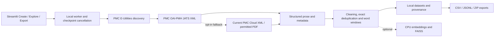

<!-- SPDX-FileCopyrightText: 2026 Kiran Upadhyay -->
<!-- SPDX-License-Identifier: Apache-2.0 -->

# Biomedical Dataset Studio

A local application for collecting PubMed Central Open Access literature and turning it into traceable biomedical datasets. Search, inspect structured text and chunks, then export the results with licenses and processing provenance intact.

[Apache-2.0 software license](LICENSE) · [User guide](docs/USAGE.md) · [Validation](docs/VALIDATION.md) · [Third-party terms](THIRD_PARTY_NOTICES.md)

## What it does

- Discover articles from a biomedical query and configurable candidate limit.
- Prefer supported PMC JATS XML; preserve document sections and paragraphs.
- Clean text, detect exact duplicates and create overlapping, source-attributed chunks.
- Reuse cached responses, retry transient requests and record per-article failures.
- Show live progress, stop at processing checkpoints and reopen saved runs.
- Export metadata CSV/JSON, structured article JSONL, chunk JSONL and a complete ZIP with SHA-256 checksums.
- Optionally use publisher-permitted PDF fallback or build a CPU FAISS index.

Standard collection needs no GPU, BioMistral, model download, paid API, database or account. This repository is independent of the original research prototype: it includes every required processing helper and imports no capstone package.

## Architecture



Source requests share the existing disk cache. The worker does no Streamlit rendering; the interface polls progress and keeps results in session state. Every run has its own directory.

## Installation

Python 3.10 or later is required; Python 3.12 on Windows was used for release validation.

```powershell
git clone https://github.com/UpadhyayKiran/biomedical-dataset-studio.git
cd biomedical-dataset-studio
python -m venv .venv
.\.venv\Scripts\Activate.ps1
python -m pip install -e .
python -m streamlit run dataset_studio_app.py
```

On Linux/macOS, activate with `source .venv/bin/activate`. Open the local URL printed by Streamlit, normally `http://localhost:8501`.

The default installation is the XML collection and Studio interface. Optional dependencies remain separate:

```powershell
# PDF fallback: PyMuPDF is AGPL/commercial, not Apache-2.0.
python -m pip install -e ".[pdf]"
# CPU indexing; model weights are not included.
python -m pip install -e ".[index]"
# Automated tests
python -m pip install -e ".[test]"
python -m pytest -q
```

Read the [licensing audit](docs/LICENSING.md) before enabling PDF fallback, redistributing combined software, or using model weights commercially. Optional PDF/index tests skip if their dependencies are absent; the release validation documents which were installed.

## Use the Studio

1. **Create Dataset:** enter a query, for example `remote patient monitoring AND cc_by_license[filter]`, choose an article limit, and start processing. Optional settings control chunk size, overlap, cache refresh and permitted PDF fallback. Indexing is disabled until the local embedding-model check succeeds.
2. **Explore Dataset:** inspect article metadata, processed sections, individual chunks, source URLs, licenses, provenance and processing statistics. Failed and duplicate records remain visible in audit logs.
3. **Export Dataset:** download individual files or prepare the complete ZIP. Use the sidebar to reopen a saved run after restarting the app.

The article limit counts discovered candidates, not guaranteed successful exports. **Stop processing** preserves completed articles at the next checkpoint. An active request or embedding batch must return first.

## Command-line and Python use

```powershell
python -m biomedical_dataset_studio "remote patient monitoring AND cc_by_license[filter]" --limit 20
biomedical-dataset-studio "cancer immunotherapy" --limit 10 --chunk-size 500 --overlap 100
```

```python
from biomedical_dataset_studio.pipeline import PipelineOptions, run_pipeline

manifest = run_pipeline(
    PipelineOptions(query="atrial fibrillation mobile health", article_limit=20),
    on_progress=lambda event: print(event),
)
print(manifest["run_dir"])
```

Use `--help` for CLI options. The UI only loads an already cached/local embedding model; CLI indexing may download the configured model. The default model is **CC BY-NC 2.0**, separate from this software license.

## Configuration and outputs

```powershell
$env:BIOMEDICAL_DATASET_STUDIO_WORKSPACE = "C:\local-data\biomedical-studio"
$env:NCBI_EMAIL = "your-contact-address"
# Optional: NCBI_API_KEY, BIOMEDICAL_DATASET_STUDIO_EMBED_MODEL
```

Defaults are relative to the directory from which you launch the app: `workspace/dataset_studio/cache/` and `workspace/dataset_studio/runs/<run-id>/`. `.env.example` is a reference; `.env` is not loaded automatically. Keep generated datasets private unless their article licenses permit redistribution.

Each run contains `metadata.csv`, `metadata.json`, `articles.jsonl`, `chunks.jsonl`, `failures.jsonl`, `duplicates.jsonl`, `progress.jsonl` and `manifest.json`. The ZIP also includes `export_manifest.json` with file sizes and SHA-256 values. Successful optional indexes add `faiss_index.index` and aligned `chunk_metadata.json`.

## Validation and limits

The originating V1 audit collected **20 CC BY-filtered articles and 323 chunks**. This extraction has its own [standalone validation record](docs/VALIDATION.md); historical research evaluation results are not included or reused as a benchmark.

- Designed for local, single-user operation; rate limits are not coordinated across sessions/processes. PMC requests within a job are sequential and paced below three per second. Follow PMC's off-peak guidance for more than 100 requests.
- Cancellation is cooperative. Closing the browser does not stop a worker; hard process termination can lose in-memory work. Interrupted runs do not automatically resume.
- Large runs and ZIP downloads use memory. Empty searches and partial failures are valid outcomes, not guarantees of dataset completeness.
- Text extraction preserves prose, not tables, figures, full mathematical layout or every article element. Deduplication is exact, not semantic. Source metadata can be incomplete.
- Cached source snapshots can become stale. Original article terms govern reuse and redistribution, even when software is open source.
- Real-model indexing, live PDF fallback, cross-platform clean installation and multi-user hosting are outside the originating V1 validation scope. See the standalone record for the exact checks executed for this release.

## License and acknowledgements

Copyright **2026 Kiran Upadhyay**. The original Studio source and documentation are licensed under the [Apache License 2.0](LICENSE). See [NOTICE](NOTICE), [source provenance](docs/SOURCE_PROVENANCE.json) and [third-party notices](THIRD_PARTY_NOTICES.md).

**Downloaded biomedical articles retain their respective licenses and are not covered by the software license.** Third-party dependencies and optional model weights also retain their own licenses. No article bodies, weights, credentials or historical capstone results are distributed here.

Thanks to NCBI/NLM and PMC, and to the maintainers of Streamlit, Requests, NumPy, FAISS, Sentence Transformers, PyMuPDF and their dependencies. This project is not affiliated with or endorsed by NCBI, NLM, NIH or the Apache Software Foundation. The implementation was extracted from the maintainer's research prototype; that repository remains unchanged.

No patent ownership or patentability claim is made. Apache-2.0 provides the patent license described in its terms; it does not grant patent ownership.
